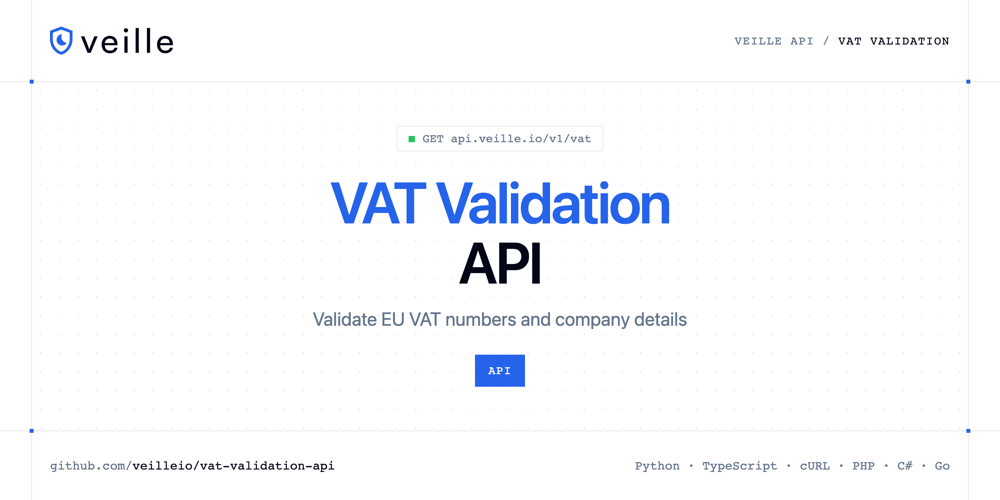

<p align="center">
  <a href="https://www.veille.io"></a>
</p>

# VAT Validation API

[](https://discord.gg/CFj3ph8aHU) [](https://app.veille.io/register) [](https://app.veille.io/openapi) [](LICENSE)

The **Veille VAT Validation API** validates VAT numbers so your B2B invoicing and reverse-charge logic rely on verified data.

- **VAT Validation API** — Validate a European VAT number against the VIES database.

Use it at checkout, in billing systems and for B2B onboarding.

| Endpoint | Request | Credits |
|---|---|---|
| [VAT Validation API](#vat-validation-api) | `GET /v1/vat` | 1 |

## Table of contents

- [How it works](#how-it-works)
- [VAT Validation API](#vat-validation-api)
- [Code examples in other languages](#code-examples-in-other-languages)
- [Use cases](#use-cases)
- [Why Veille?](#why-veille)
- [FAQ](#faq)
- [Related repositories](#related-repositories)
- [Support](#support)

## How it works

1. **Create a Veille account** and copy your API key from the [dashboard](https://app.veille.io/register).
2. **Call `https://api.veille.io`** with the header `x-api-key: YOUR_API_KEY`.
3. **Use the result** in your app — no infrastructure to run.

```bash
export VEILLE_API_KEY="your-api-key"
pip install requests        # Python
# TypeScript: Node.js 18+ (native fetch), run with `npx tsx file.ts`
```

## VAT Validation API

Validate a European VAT number against the VIES database. Returns company name, registered address, and validity status for any EU member state.

`GET https://api.veille.io/v1/vat` · **1 credit per request** · [API reference](https://app.veille.io/openapi)

### Request parameters

| Parameter | In | Type | Required | Description |
|---|---|---|---|---|
| `query` | query | string | ✅ | The VAT number to validate (e.g. FR40303265045). |

### Python example

```python
import os

import requests

API_KEY = os.environ["VEILLE_API_KEY"]
HEADERS = {"x-api-key": API_KEY}

response = requests.get(
    "https://api.veille.io/v1/vat",
    headers=HEADERS,
    params={
        "query": "YOUR_VALUE",
    },
    timeout=120,
)
response.raise_for_status()

data = response.json()
print(data)
```

### TypeScript example

```typescript
type VatValidationApi = {
  valid?: boolean;
  vat_number?: string;
  company_name?: string;
  country_code?: string;
  company_address?: string;
};

const headers = { "x-api-key": process.env.VEILLE_API_KEY!, "Content-Type": "application/json" };

const params = new URLSearchParams({
  "query": "YOUR_VALUE",
});

const response = await fetch(`https://api.veille.io/v1/vat?${params}`, { headers });
if (!response.ok) throw new Error(`HTTP ${response.status}: ${await response.text()}`);

const data = (await response.json()) as VatValidationApi;
console.log(data);
```

### Output example

Example response from the API reference, abridged.

```json
{
  "valid": true,
  "vat_number": "FR40303265045",
  "company_name": "LVMH MOET HENNESSY LOUIS VUITTON",
  "country_code": "FR",
  "company_address": "22 AVE MONTAIGNE 75008 PARIS"
}
```

### Response fields

| Field | Type | Description |
|---|---|---|
| `valid` | boolean |  |
| `vat_number` | string |  |
| `company_name` | string |  |
| `country_code` | string |  |
| `company_address` | string |  |

## Code examples in other languages

Ready-to-run examples live in [`examples/`](examples); each reads your key from `VEILLE_API_KEY`.

| Language | `vat` |
|---|---|
| cURL (Bash) | [vat.sh](examples/curl/vat.sh) |
| PHP | [vat.php](examples/php/vat.php) |
| C# | [Vat.cs](examples/csharp/Vat.cs) |
| Go | [vat.go](examples/go/vat.go) |
| Java | [VatExample.java](examples/java/VatExample.java) |
| Ruby | [vat.rb](examples/ruby/vat.rb) |
| Node.js | [vat.mjs](examples/nodejs/vat.mjs) |

## Use cases

- **B2B checkout** — Validate VAT numbers before applying reverse charge.
- **Onboarding** — Verify company VAT numbers during KYB.

## Why Veille?

- **Stop fake sign-ups** — validate emails and domains before creating accounts.
- **Block abuse** — check IP reputation to stop bots and automated attacks.
- **Clean billing data** — validate VAT numbers and IBANs, get exchange rates.
- **Fast** — designed to run inline in sign-up and checkout flows.
- **Copy-paste examples** — Python and TypeScript in each README, 7 more languages in `examples/`.

## FAQ

### How do I authenticate?

Create an account on [Veille](https://app.veille.io/register), copy your API key and send it in the `x-api-key` header of every request to `https://api.veille.io`.

### How much does a request cost?

Credits per call: `/v1/vat` **1**. See [Veille pricing](https://www.veille.io/pricing).

### Which languages are supported?

Any language that can make an HTTP request. This README shows Python and TypeScript; the [`examples/`](examples) folder contains cURL, PHP, C#, Go, Java, Ruby and Node.js.

## Related repositories

- [Email Validation API](https://github.com/veilleio/email-validation-api)
- [Email Qualification API](https://github.com/veilleio/email-qualification-api)
- [Domain Validation API](https://github.com/veilleio/domain-validation-api)
- [IP Reputation API](https://github.com/veilleio/ip-reputation-api)
- [IBAN Validation API](https://github.com/veilleio/iban-validation-api)
- [Exchange Rates API](https://github.com/veilleio/exchange-rates-api)
- [All Veille repositories](https://github.com/veilleio)

## Support

- 💬 Join the [Discord](https://discord.gg/CFj3ph8aHU) to ask questions and share what you build.
- 📚 Read the [API reference](https://app.veille.io/openapi).
- 🔑 [Get your API key](https://app.veille.io/register).

---

<p align="center">
  <a href="https://www.veille.io">
    <picture>
      <source media="(prefers-color-scheme: dark)" srcset="images/logo-dark.svg">
      
    </picture>
  </a>
  <br>
  <sub>Built by <a href="https://www.veille.io">Veille</a>. Examples are released under the MIT license.</sub>
</p>
